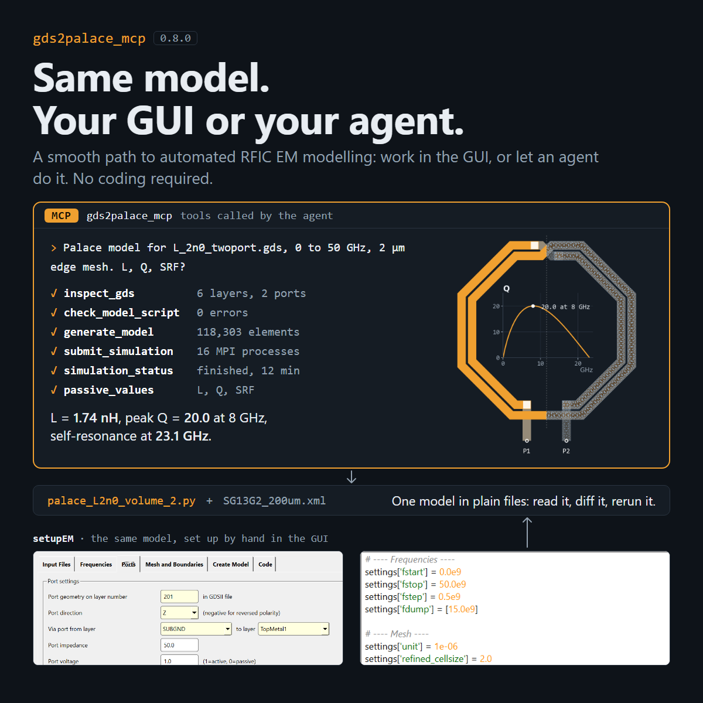

# gds2palace_mcp



An [MCP](https://modelcontextprotocol.io) server for
[gds2palace](https://github.com/VolkerMuehlhaus/gds2palace_ihp_sg13g2). It lets an AI assistant (Claude Code,
Claude Desktop, or any other MCP client) inspect GDSII layouts and stackup files, check model scripts, and generate
AWS Palace models on your computer.

The server runs locally, in the same Python environment as gds2palace, and works with the files on your disk. It
does not run the Palace solver: Palace runs on Linux, as before (`run_sim`, see the gds2palace documentation).

## Installation

```
pip install gds2palace_mcp
```

This also installs gds2palace and its requirements (gdspy, gmsh, shapely, numpy), gds_prepare_for_EM, gds_viewer,
plot_snp and scikit-rf. It needs gds2palace 0.9.2 or newer, which ships the IHP stackup files and the result tools.

Add the server to Claude Code, using the Python environment where it is installed:

```
claude mcp add gds2palace -- python -m gds2palace_mcp.server
```

Or, without installing anything first (needs [uv](https://docs.astral.sh/uv/)):

```
claude mcp add gds2palace -- uvx gds2palace_mcp
```

For Claude Desktop and other clients, add the same command to the client's MCP server configuration.

## What it offers

| Tool | What it does |
|---|---|
| `list_stackups` | The IHP stackup files that ship with gds2palace (SG13G2, SG13G2 with conformal passivation, SG13CMOS5L) |
| `inspect_stackup` | Variables, materials, dielectrics, layers with GDS numbers and z positions, derived layers, free port layer numbers. Accepts variable overrides such as `{"total_thickness": 100}` |
| `inspect_gds` | Per layer: number of shapes, extent, smallest shape and smallest gap (for choosing the mesh size and via merging). With a stackup, the role of each layer, and which layers gds2palace ignores |
| `check_layout_complexity` | Before meshing: polygon count per layer (only layers the stackup uses, without flattening the layout, so it is fast for dense fill and via arrays), layout size, polygon density, the layers that dominate, and simplification hints. A report, no pass/fail limit |
| `simplify_layout` | Writes a simplified copy of the layout, like setupEM's Tools > Simplify GDS: remove floating dummy fill, fill small cutouts, merge via arrays, merge each layer. Layers come from the stackup; returns polygon counts before and after |
| `suggest_mesh_size` | Before the mesh settings are discussed: traces and coupled lines on the top 2 conductor layers with shapes, and the `refined_cellsize` that follows from their smallest width or gap (IHP: accurate 2 µm, quick 5 µm by default; other technologies: the smallest feature itself; never larger than the smallest feature), also as a per-layer override |
| `check_model_script` | Checks a model script without running it: settings that gds2palace doesn't read (typos such as `nogui` are silently ignored by gds2palace), missing required settings, port layers missing from the layer list, removed or legacy settings, and a `refined_cellsize` larger than the layout's smallest trace width or coupled-line gap |
| `generate_model` | Runs the model script without gmsh windows and checks the output: `config.json`, mesh with node and element counts, `port_information.json`, `run_sim`. With `save_geometry`, it also saves the unmeshed geometry |
| `show_in_gmsh` | Opens the mesh, or the unmeshed geometry, in the gmsh GUI on the user's screen |
| `preview_layout` | The layout as an image (via [gds_viewer](https://github.com/VolkerMuehlhaus/gds_viewer)) with the ports labelled, for the assistant to look at. IHP SG13G2 colors and patterns; for other technologies, colors from the stackup materials, with a legend |
| `summarize_results` | Summary of finished Palace runs (gds2palace's palace_summary): unknowns, mesh elements, run time, peak RAM, AMR convergence (Max \|ΔS\| per iteration, optional plot), Touchstone files found, "did NOT converge" in saved logs |
| `sparameter_summary` | Numbers from Touchstone files: ports, frequency range, passivity and reciprocity, dB minimum/maximum, dB/phase at chosen frequencies |
| `plot_sparameters` | dB/phase plots and Smith charts as images for the assistant (via [plot_snp](https://github.com/VolkerMuehlhaus/plot_snp)), several files in one plot |
| `show_sparameters` | Opens the interactive plot_snp windows on the user's screen |
| `passive_values` | L or C, R and Q of an inductor or capacitor (differential, single-ended or series), peak Q, self-resonance frequency, optional L/Q plot |

Resources: `gds2palace://agents-guide` (gds2palace's [AGENTS.md](https://github.com/VolkerMuehlhaus/gds2palace_ihp_sg13g2/blob/main/AGENTS.md):
workflow, script template, settings, pitfalls) and `gds2palace://stackups/<file>` (the bundled stackup files and their
README).

Prompt: `new_model` starts a new model: it inspects the layout and asks you for the design decisions (frequency
range, ports, stackup, accuracy) before writing the script.

New to MCP? [docs/README.md](https://github.com/VolkerMuehlhaus/gds2palace_mcp/blob/main/docs/README.md) explains what this can and can't do for an RFIC designer, and
[docs/example_session.md](https://github.com/VolkerMuehlhaus/gds2palace_mcp/blob/main/docs/example_session.md) shows a full session with an inductor.

## Notes

- All paths are paths on the computer where the server runs.
- `generate_model` runs the script with the Python of the server's environment. If the script adds a local
  `gds2palace` folder to `sys.path`, that copy is used; the result shows which gds2palace version and file were used.
- With the stdio transport, gds2palace's printed output is captured and returned in the tool results.

## License

GPL-3.0-or-later, like gds2palace.
