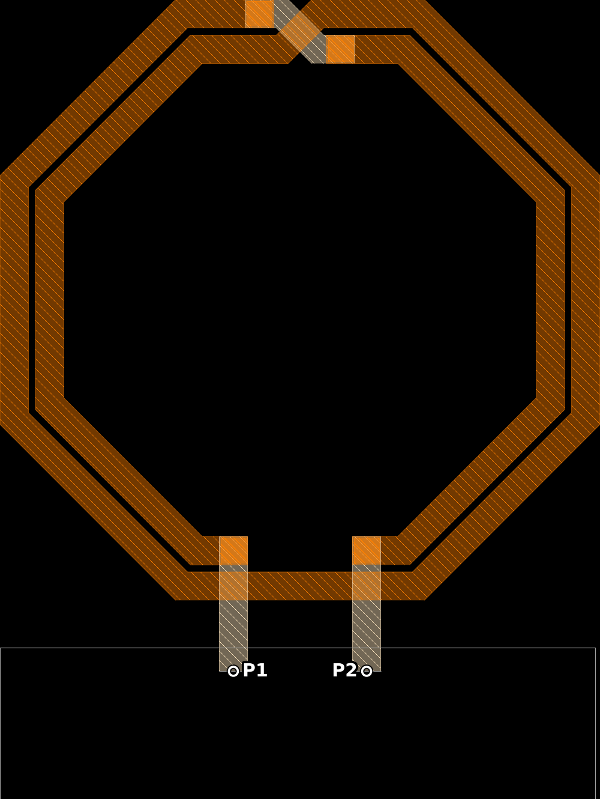
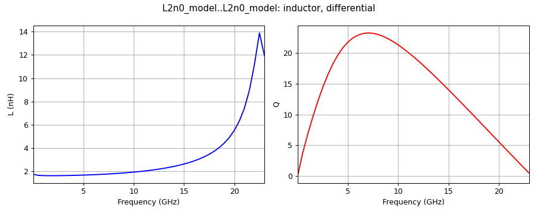

# Example session: from an inductor layout to L and Q

This is a complete session with Claude Code and the gds2palace MCP server: from a layout to a Palace model, the
Palace run, and the inductor's L and Q. The layout is `L_2n0_twoport.gds`, a 2-turn octagon inductor in IHP SG13G2,
from the gds2palace examples.

Every step has two views:

- **In the terminal**: what you type, what Claude answers, and the windows that open on your screen.
- **Under the hood** (click to open): which tools Claude called and what they returned. You don't need this part to
  use the server; it shows where Claude's answers come from.

All numbers are from a real run (gds2palace_mcp 0.8.0, gds2palace 0.9.2, a Windows laptop with Palace in WSL). Claude
writes its answers freshly each time, so the wording in your session will differ. What stays the same is the order:
look at the inputs, ask you, write and check the script, build the model, run Palace, read the results.

**Before you start:** the MCP server is set up (see [Setup](README.md#setup)). For step 4, Palace has a place to run:
here a targets file with the laptop's WSL ([Running Palace](README.md#running-palace)):

```toml
[targets.laptop]
type = "local"
description = "WSL on this laptop (Ubuntu-24.04)"
```

## 1. Say what you want

### In the terminal

Start Claude Code in the folder with the layout:

```
cd d:\designs\inductor
claude
```

> **You:** I have L_2n0_twoport.gds, a 2-turn inductor in SG13G2. I want a Palace model for S-parameters up to
> 50 GHz.

While Claude works, Claude Code shows each tool it uses as a short line, which you can expand to see what was sent
and returned. The first time a tool is used, Claude Code asks you to allow it, once or for the rest of the session.
Then Claude answers:

> **Claude:** The layout (cell `L_2n0_simplify`, 254 × 338 µm) has:
>
> | Layer | In the stackup | What it is |
> |---|---|---|
> | 134 | TopMetal2 | the coil, 12 µm wide, turns 3.0 µm apart |
> | 133 | TopVia2 | 4 vias between the coil and the underpass |
> | 126 | TopMetal1 | underpass and the two feed lines |
> | 250 | SUBGND | ground sheet under the feed lines |
> | 201, 202 | not in the stackup | one zero-width line each: your ports |
>
> I looked at the layout: the port lines sit at the ends of the two feed lines, above the SUBGND sheet. There are no
> fill or via arrays to simplify.
>
> Before I write the script, please confirm:
>
> 1. Ports: port 1 on layer 201 and port 2 on layer 202, each from SUBGND up to TopMetal1, 50 Ω?
> 2. Stackup: `SG13G2_FEM_200um.xml` (planar passivation, 200 µm chip), or the conformal passivation variant?
> 3. Frequency: 0 to 50 GHz in 0.5 GHz steps?
> 4. Mesh: the turns are 3 µm apart, so the mesh cells along the metal edges must not be larger: I suggest
>    `refined_cellsize = 2` µm (2.5 µm is the largest that still fits) and FEM order 2. OK?

Claude read the gap between the turns from the layout and suggested the mesh size from it. It did not decide the
port connection, the stackup or the frequency range: those are your decisions.

<details>
<summary><b>Under the hood</b></summary>

Claude first reads the gds2palace guide for AI assistants (the resource `gds2palace://agents-guide`), then calls:

| Tool | Main inputs | What it returned (shortened) |
|---|---|---|
| `list_stackups` | | the three IHP stackups that ship with gds2palace (`SG13G2_FEM_200um.xml`, its conformal passivation variant `..._passi3D.xml`, `SG13CMOS5L_200um.xml`), and the installed versions |
| `inspect_gds` | layout, stackup `SG13G2_FEM_200um.xml` | cell `L_2n0_simplify`, size 254 × 338 µm; per layer the shape count, smallest shape and smallest gap (TopMetal2: 2 shapes, gap 2.998 µm) and its role in the stackup; layers 201/202 "not in stackup: conventional port layer range" |
| `suggest_mesh_size` | layout, stackup | traces on TopMetal2 and TopMetal1 (12 µm wide), six coupled-line sections on TopMetal2 with a 2.998 µm gap; suggested `refined_cellsize`: accurate 2.0 µm, quick 2.5 µm |
| `check_repeated_patterns` | layout, stackup | 10 polygons read by the model, none in repeated patterns: no preprocessing needed |
| `preview_layout` | layout, ports {1: 201, 2: 202} | the picture below, which Claude looks at to check the port positions |



</details>

## 2. Claude writes and checks the script

### In the terminal

> **You:** Yes to all four.

> **Claude:** I wrote `L2n0_model.py` from the template in the gds2palace guide, with your answers filled in, and
> checked it: no problems found. Shall I build the model?

The script is a normal gds2palace model script in your folder; you can open it, change it and run it yourself.

<details>
<summary><b>Under the hood</b></summary>

The important lines of `L2n0_model.py`:

```python
gds_filename = "L_2n0_twoport.gds"
XML_filename = utilities.get_stackup_path("SG13G2_FEM_200um.xml")   # ships with gds2palace
...
settings['fstart'] = 0               # Hz, 0 is replaced by a small value (no DC in FEM)
settings['fstop'] = 50e9
settings['fstep'] = 0.5e9
settings['refined_cellsize'] = 2     # um, mesh size at metal edges (3 um gap between the turns)
settings['order'] = 2
settings['no_gui'] = True            # no gmsh window: required for unattended runs
...
simulation_ports.add_port(simulation_setup.simulation_port(
    portnumber=1, voltage=1, port_Z0=50, source_layernum=201,
    from_layername='SUBGND', to_layername='TopMetal1', direction='z'))
simulation_ports.add_port(simulation_setup.simulation_port(
    portnumber=2, voltage=1, port_Z0=50, source_layernum=202,
    from_layername='SUBGND', to_layername='TopMetal1', direction='z'))
```

`check_model_script` found no errors, warnings or remarks. What it catches: with a typo,
`settings['nogui'] = True` instead of `no_gui`, it reports

> line 26: settings['nogui'] is not read by gds2palace and not by this script, so it has no effect. Did you mean
> 'no_gui'?

gds2palace itself gives no error for this: the script would open a gmsh window and wait, which on a computer without
a screen looks like a hang. The same check finds missing required settings, and ports whose GDS layer is never read.

</details>

## 3. Claude builds the model

### In the terminal

> **You:** Yes, build it.

A terminal window opens on your screen and shows the meshing log live (gmsh). Closing it doesn't stop the meshing.
For this inductor it took 10 seconds; large layouts or fine meshes take minutes.

> **Claude:** The model is ready in `palace_model\L2n0_model_data`: the mesh has 101,847 elements (81,851
> tetrahedra, 4.7 MB).
>
> **Estimate for Palace:** about 555,000 unknowns, and a peak RAM of about 7.9 GB (at most 10.2 GB) over all MPI
> processes.
>
> Two warnings, both expected:
> - The start frequency was moved from 0 to 0.01 GHz: FEM can't solve at DC. The Touchstone conversion adds an
>   extrapolated DC point later, in a separate `_dc` file.
> - gmsh reports 8 ill-shaped tetrahedra. A few of these are normal near thin layers; there were 0 mesh errors.
>
> Your targets file has one target, `laptop` (WSL on this computer). Shall I run Palace there?

<details>
<summary><b>Under the hood</b></summary>

`generate_model` ran the script without gmsh windows (the log goes to `L2n0_model_generate.log` and to the window)
and checked what it wrote:

| Field | Value |
|---|---|
| files in `palace_model/L2n0_model_data` | `config.json`, `port_information.json`, `run_sim`, `L2n0_model.msh` |
| mesh | 18,019 nodes, 101,847 elements, 81,851 tetrahedra, 4.7 MB |
| estimate | 555,000 unknowns (519,000 to 591,000), peak RAM typical 7.9 GB, worst case 10.2 GB |
| important lines | "Start frequency changed from DC to 0.01 GHz", "8 ill-shaped tets are still in the mesh", "0 errors" |

The estimate is calibrated on earlier Palace runs in the gds2palace repository: unknowns per tetrahedron for FEM
order 2 (163 runs), and peak RAM per unknown (158 runs).

</details>

## 4. Palace runs

### In the terminal

> **You:** Yes, run it on the laptop.

> **Claude:** The laptop has 15.7 GB of RAM free, enough for the estimated 7.9 GB, and no Palace is running there.
> I started Palace in WSL; a second terminal window shows its log. It will take a while: ask me any time how far it
> is.

A terminal window opens with the Palace log. As before, closing it doesn't stop the run. You can go on working, or
ask:

> **You:** How far is it?

> **Claude:** Palace is running with 8 processes and uses 4.8 GB so far. It is building the reduced-order model
> for the adaptive frequency sweep, at port 1 of 2. No solver problems in the log.

<details>
<summary><b>Under the hood</b></summary>

| Tool | What it did |
|---|---|
| `list_targets` with `check` | target `laptop` reachable, `run_palace` found, 16.4 GB RAM (15.7 GB free), no Palace processes running |
| `submit_simulation` | started `run_palace config.json` in WSL in the model folder, in the background; the run and its log (`palace.log`) stay in `palace_model/L2n0_model_data`, the job is recorded in `mcp_palace_job.json` there |
| `simulation_status` (after 1 minute) | running; 8 MPI processes of this run, 4.8 GB; phase "building the reduced-order model (adaptive sweep)", port 1/2; 0 "did NOT converge" lines; the last 15 log lines |

The run doesn't depend on the conversation: you can close Claude Code, and `simulation_status` finds the run again
later from `mcp_palace_job.json`. The MCP server never stops a run; to end one, end its processes yourself.

</details>

## 5. Results: L and Q

### In the terminal

> **You:** Is it done?

> **Claude:** Yes, Palace finished after 20 minutes without errors. I made the Touchstone files: the result is
> `L2n0_model.s2p` in `palace_model\L2n0_model_data\output\L2n0_model\`, plus a version with an extrapolated DC point
> (`_dc`) and one with the port inductance removed (`_deembedded`).
>
> The run had 570,848 unknowns and a peak RAM of 7.52 GB, close to the estimate (555,000 and 7.9 GB).

> **You:** What are L and Q of the inductor?

> **Claude:** How is the inductor used: between port 1 and port 2 (floating), or with port 2 to ground?

> **You:** Between port 1 and port 2.

> **Claude:** From port 1 to port 2:
>
> | | |
> |---|---|
> | L at low frequency | 1.74 nH |
> | L and Q at 10 GHz | 1.91 nH, Q = 21.3 |
> | Peak Q | 23.2 at 7 GHz |
> | Self-resonance | 23.3 GHz |
>
> L rises toward the self-resonance, and Q falls above 7 GHz.

To see the curves yourself, ask "show me S11 and S21 of L2n0_model.s2p": the plot windows open on your screen.

<details>
<summary><b>Under the hood</b></summary>

| Tool | What it returned |
|---|---|
| `simulation_status` | finished, exit code 0, 0 "did NOT converge" lines |
| `fetch_results` | for a local target the results are already in place; it ran gds2palace's `combine_extend_snp` (as `combine_snp` does) and returned the run summary: 570,848 degrees of freedom, 81,851 mesh elements, 19 min 56 s, peak RAM 7.52 GB |
| `passive_values` with `connection: differential`, `plot` | L, R and Q from Z = Z11 − Z12 − Z21 + Z22: L 1.744 nH and R 1.24 Ω at 0.01 GHz; at 10 GHz L 1.913 nH, R 5.65 Ω, Q 21.3; peak Q 23.19 at 7 GHz; self-resonance 23.30 GHz; and the plot below, which Claude looks at |



</details>

Check the result against something you know, for example the PDK model or a measurement of the same inductor. The
gds2palace examples include such a comparison for another inductor (L6n2) in `more_examples/measured_vs_simulated/`.

## Things to try next

- "Use the conformal passivation stackup instead and compare the mesh size."
- "Make the chip 100 µm thick." (Claude uses the stackup variable `total_thickness`, no XML editing.)
- "What changes if I use `conductor_model = 'solve_inside_skin'`?" (Claude explains it from the guide; generating
  the model shows the cost in mesh size.)
- "Fit a SPICE model to L2n0_model.s2p." (equivalent circuit with snp2le)
- "Check all model scripts in this folder."
